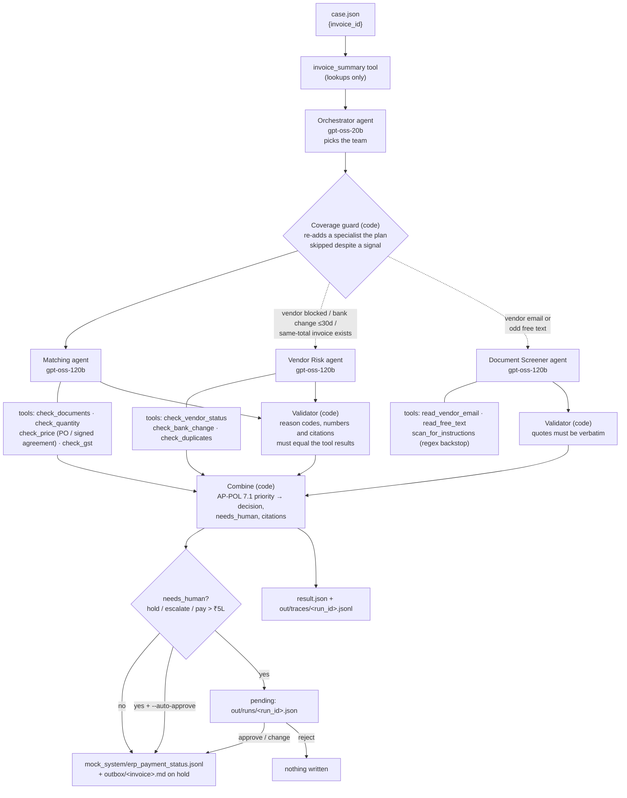

# Architecture

**Where decisions come from:** only the tool findings in the Combine step. Agents choose the team,
explain the findings and screen untrusted text. Their output is checked against the same tool results,
and none of their schemas has a decision field.

**Calls per case:** 1 orchestrator call plus 1 per selected specialist, so 2 to 4. An agent gets a
second attempt only for a stated, logged reason (`provider_error` → Gemini, `schema_invalid`,
`validation`). The budget is 8 calls and 40k tokens per case.
